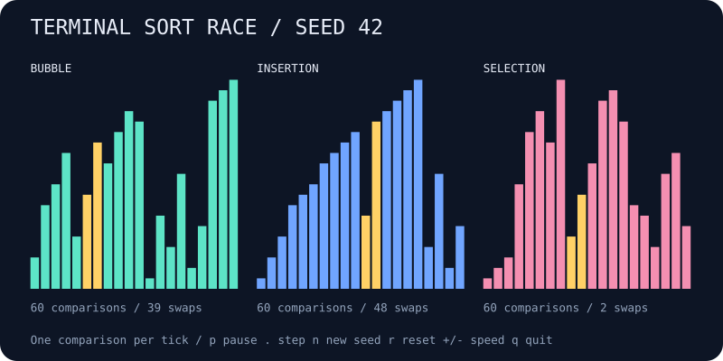

# terminal-sort-race

Watch bubble, insertion, and selection sort rearrange the same seeded bars. Pause, step through a comparison, or try already sorted and reversed inputs to see their different behavior.



## Run

```bash
npx --yes github:b69ca/terminal-sort-race
npx --yes github:b69ca/terminal-sort-race --order reversed
npx --yes github:b69ca/terminal-sort-race --order sorted
```

Node.js 20 or newer. No runtime dependencies. Everything runs locally.

## Play

| Key | Action |
| --- | --- |
| `p` or Space | Pause / resume |
| `.` | Pause and advance each unfinished sort by one comparison |
| `n` | Restart using the next seed |
| `r` | Restart the current race |
| `+` / `-` | Faster / slower animation |
| `q` or Ctrl-C | Quit and restore the terminal |

Yellow bars show the active comparison. Finished panels turn green in the terminal. The race stays open after completion so you can inspect counters or restart. Changing the seed affects random order only.

## Export and compare

```bash
# A snapshot of the algorithms partway through the same race
npx --yes github:b69ca/terminal-sort-race --seed 42 --ticks 60 --svg race.svg

# Solve all three and compare their exact operation counts
npx --yes github:b69ca/terminal-sort-race --seed 42 --solve --json

# Capture a plain final chart
npx --yes github:b69ca/terminal-sort-race --solve > sorted.txt
```

## Options

```text
--seed N                    unsigned 32-bit seed (default: 42)
--size N                    bar count from 3 to 60 (default: 20)
--order random|sorted|reversed  initial arrangement (default: random)
--ticks N                   comparisons per algorithm before display; 0–100000
--frames N                  finite terminal session; 0–100000
--solve                     finish all algorithms before display
--json                      print state and counters instead of animating
--svg FILE                  save a static SVG instead of animating
--no-color                  disable ANSI colors
--help                      show usage
```

JSON and SVG can be combined. Neither accepts `--frames`. Without `--solve`, exports show the current state after any requested `--ticks`; they do not solve automatically. A finite session displays its starting state first, then advances between frames; paused frames still count. `--solve` runs after `--ticks`.

Without a TTY, output defaults to one plain frame with 20 bars and no escape sequences. Live defaults reduce bar count for the terminal width, and charts use up to 18 rows. Allow at least 80 columns for a comfortable three-panel view; larger explicit sizes need more columns. `NO_COLOR=1` also disables colors. Quitting restores the screen, cursor, and input mode. Exit codes are 0 for success and 2 for argument or file errors.

## What the race measures

Each unfinished algorithm performs exactly one value comparison per tick. Swap counters count exchanges of two positions. Bubble sort stops early after a pass without swaps; insertion sort uses adjacent swaps; selection sort swaps the selected minimum into place after each scan.

This compares operation counts, not runtime performance. Tick duration includes animation overhead, and the three algorithms run sequentially within each displayed frame. Generated values are a permutation of 1 through the bar count. JSON includes the initial array and each algorithm's current array, comparisons, swaps, ticks, and completion status.

## Library

Install with `npm install github:b69ca/terminal-sort-race`, then:

```js
import { createRace, createSort, step, analyze } from 'terminal-sort-race';
const race = createRace({ seed: 42, size: 20 });
race.sorts.forEach(sort => step(sort, 60));
console.log(analyze(race));
const sort = createSort([3, -1, 3, 0], 'insertion');
while (!sort.done) step(sort);
console.log(sort.values); // [-1, 0, 3, 3]
```

`createSort()` copies its input and accepts 1–1000 finite numbers, including duplicates and negatives. `step()` mutates and returns the sort state. The bar renderers are intended for positive permutation races created by `createRace()`.

## Development

```bash
npm ci
npm run check
```

Tests cover correctness across seeds, multiset preservation after every comparison, duplicate and negative values, inversion-based swap counts, batching, counters, CLI behavior, and exports. CI runs on Node.js 20, 22, and 24.

## License

MIT
